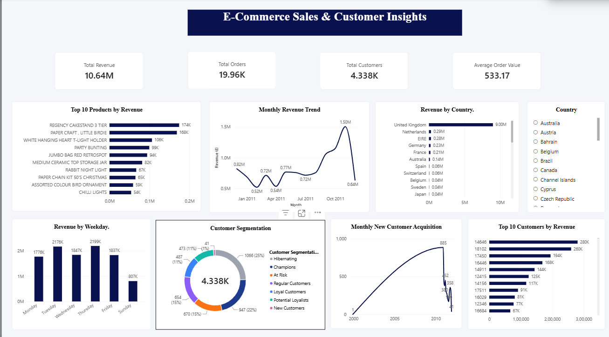

# E-Commerce Sales & Customer Insights Dashboard

## 1. Project Overview
An interactive E-Commerce Sales and Customer Insights Dashboard developed using Excel, PostgreSQL and Power BI. This project analyzes online retail transactions to understand sales performance, customer purchasing behaviour, product performance and customer segmentation.

## 2. Tools & Technologies
- **Microsoft Excel:** Data cleaning and preparation
- **PostgreSQL:** Data storage, querying and SQL analysis
- **Power BI:** Interactive dashboards and data visualization
- **DAX:** Calculated columns and measures

## 3. Data Cleaning & Preparation
- Imported and examined the UCI Online Retail dataset.
- Applied Trim and Clean transformations using Power Query.
- Identified and excluded cancelled transactions from valid sales.
- Removed non-product transactions from product-level analysis.
- Prepared cleaned data for PostgreSQL analysis and Power BI visualization.

## 4. SQL Analysis
Performed SQL analysis to identify:
- Monthly revenue and sales trends.
- Top-performing products.
- Country-wise sales performance.
- Top customers by revenue and order count.
- Repeat customer behaviour.
- Customer acquisition trends.
- Revenue performance by weekday.

## 5. Power BI Dashboard Features
- Total Revenue
- Total Orders
- Total Customers
- Average Order Value
- Monthly Revenue Trend
- Revenue by Country
- Top 10 Products by Revenue
- Customer Segmentation using RFM analysis
- Top 10 Customers by Revenue
- Monthly New Customer Acquisition
- Revenue by Weekday
- Interactive country slicer and cross-filtering.

## 6. Key Business Insights
- **Total Revenue:** £10,642,110.80
- **Total Orders:** 19,960
- **Identified Customers:** 4,338
- **Average Order Value:** £533.17
- **Repeat Customers:** 2,845
- **Repeat Customer Rate:** 65.58%

## 7. Dataset
**Source:** UCI Machine Learning Repository – Online Retail Dataset.

The dataset contains online retail transactions from December 2010 to December 2011.

## 8. Project Objective
To transform raw e-commerce transaction data into meaningful business insights and support data-driven decisions related to sales performance, product performance and customer retention.

## 9. Project Files
- Power BI Dashboard (.pbix)
- Dashboard Export (.pdf)

## 10. Skills Demonstrated
Data Cleaning | SQL | PostgreSQL | Power BI | DAX | Data Analysis | Data Visualization | Customer Segmentation
